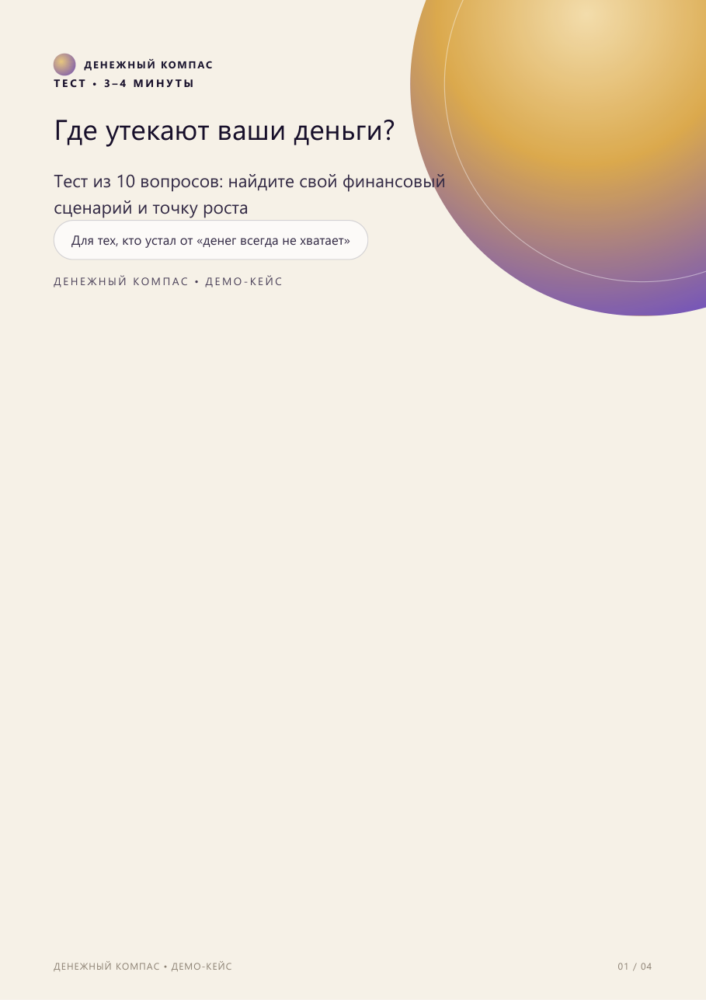
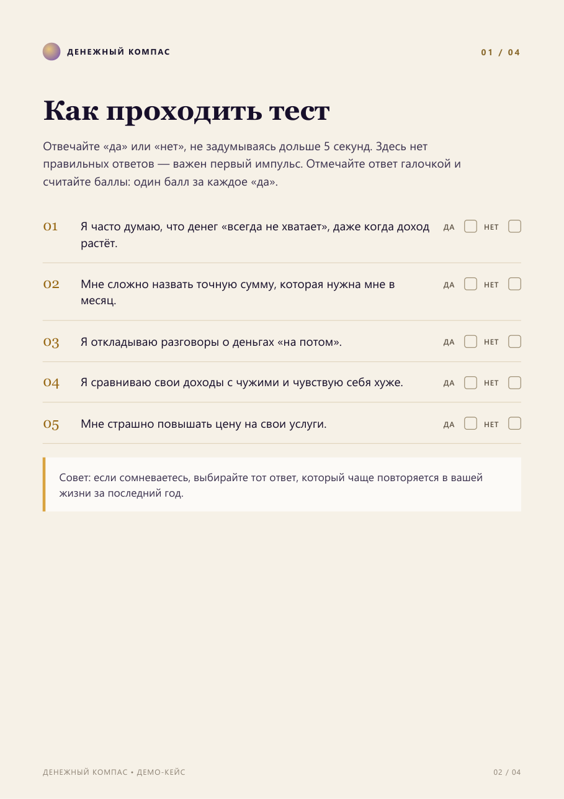
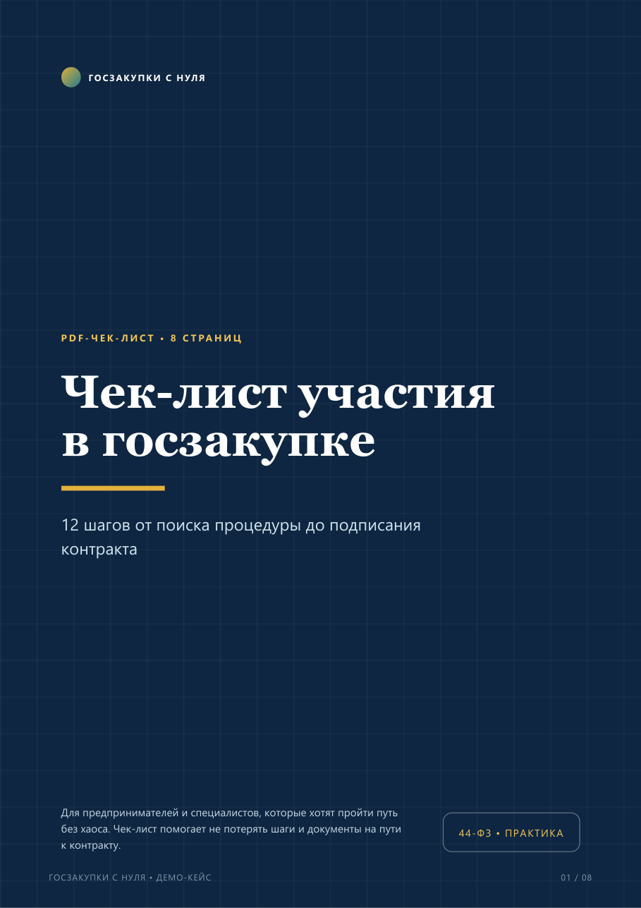
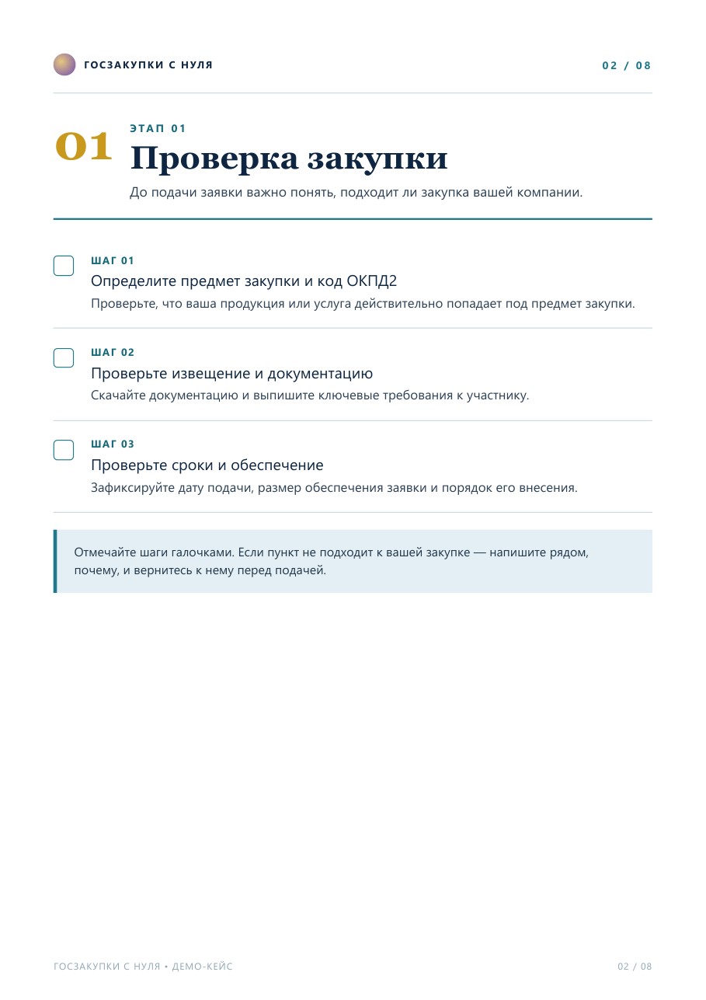

# Лид-магниты: тест и чек-лист в PDF

Два разобранных кейса по лид-магнитам. Каждый — полный путь от анализа заказа на FL.ru до готового PDF: бриф, структура, черновик, ручная редактура и дизайн.

Кейсы собраны по реальным заказам с FL.ru. Материалы сделаны как тестовые работы: заказ разобран, структура проверена на практике, текст и оформление сохранены отдельно — видно, что именно менялось после генерации.

## Кейсы

| | Кейс 1 | Кейс 2 |
|---|---|---|
| **Проект** | Тест «Где утекают ваши деньги?» + серия писем | Чек-лист участия в госзакупке |
| **Заказ на FL.ru** | [№4407802](https://www.fl.ru/projects/4407802/lid--magnit-i-seriya-pisem-v-rassyilku.html) | [№5435444](https://www.fl.ru/projects/5435444/dizayn-chek-lista-kursa-v-pdf-formate-na-figma.html) |
| **Формат** | PDF-тест на 4 страницы + 7 писем | PDF-чек-лист на 8 страниц |
| **Ниша** | Астрология и психология | Онлайн-курс по госзакупкам |
| **Аудитория** | Женщины 27–45, психология денег | Предприниматели и новички в закупках |
| **Объём** | 10 закрытых вопросов, 3 диапазона, 7 писем | 12 шагов, 4 этапа, таблица документов |
| **Время на кейс** | 2 ч 40 мин | 6 ч |
| **Цена в отклике** | 500 ₽ (рынок — 3 000–5 000 ₽) | 8 000 ₽ (рынок — 5 000–15 000 ₽) |

## Кейс 1 — тест «Где утекают ваши деньги?»

Лид-магнит для сбора контактов в нише астрологии и психологии: тест из 10 закрытых вопросов (да/нет), три диапазона результата и серия из 7 писем с приглашением на бесплатный 7-дневный марафон.





- **Что внутри:** 4 страницы — обложка и обещание; инструкция и вопросы 1–5; вопросы 6–10; подсчёт баллов и три интерпретации (0–3, 4–6, 7–10) с CTA на марафон.
- **Логика:** каждый ответ «да» — 1 балл, результат делит аудиторию на 3 группы и даёт повод для серии писем.
- **Дизайн:** «тихая роскошь» — тёмно-фиолетовый `#1B1630`, золото `#D9A441`, кремовый `#F7F2E8`; заголовки Georgia.
- **Правки после генерации:** убраны диагнозы и обещания дохода, сложные термины заменены, добавлен дисклеймер, вопросы сокращены до 10, выровнены варианты ответов и усилен CTA.

Файлы: [`case-1-test.pdf`](case-1-test-finansovye-bloki/case-1-test.pdf) · [`case-1-text.docx`](case-1-test-finansovye-bloki/case-1-text.docx)

## Кейс 2 — чек-лист участия в госзакупке

PDF-чек-лист для онлайн-курса по госзакупкам: 12 шагов от поиска закупки до подписания контракта, разбитые на 4 этапа, с таблицей документов и блоком типичных ошибок.





- **Что внутри:** 8 страниц — обложка; как пользоваться и этап 1 «Проверка закупки»; этапы 2–4 (документы, подача, контракт); таблица документов и сроков; 7 типичных ошибок; CTA и контакты.
- **Логика:** на каждом шаге — что сделать, зачем и какой документ или срок проверить; на каждой странице чекбоксы и поле для заметок.
- **Дизайн:** корпоративный, спокойный — тёмно-синий `#0F2742`, бирюза `#1F7A8C`, золото `#E3B23C`; модульная сетка 12 колонок, много воздуха, крупные чекбоксы.
- **Правки после генерации:** сокращены юридические формулировки, добавлено «проверьте в актуальной редакции», убрано обещание «выиграете тендер», выровнены шаги, добавлены таблица документов и поле для заметок.

Файлы: [`case-2-checklist.pdf`](case-2-checklist-goszakupki/case-2-checklist.pdf) · [`case-2-text.docx`](case-2-checklist-goszakupki/case-2-text.docx)

## Структура репозитория

```
lead-magnet-cases/
├── case-1-test-finansovye-bloki/
│   ├── case-1-test.pdf                  # готовый PDF-тест, 4 страницы
│   ├── case-1-text.docx                 # текст теста и 7 писем
│   ├── screenshot-1-cover.png           # обложка
│   └── screenshot-2-questions.png       # страница с вопросами
└── case-2-checklist-goszakupki/
    ├── case-2-checklist.pdf             # готовый PDF-чек-лист, 8 страниц
    ├── case-2-text.docx                 # текст 12 шагов
    ├── screenshot-1-cover.png           # обложка
    └── screenshot-2-stage.png           # этап чек-листа с шагами
```

Документы продублированы в PDF — так они открываются без Word и одинаково выглядят на любом устройстве.

## Методика

Черновики сгенерированы по отдельным промптам на структуру и текст, затем отредактированы вручную по чек-листу: польза, факты, понятность, CTA, формат. Макеты собраны в HTML/CSS и экспортированы в PDF через Chrome; сетка легко повторяется в Figma или Canva.

Что пришлось исправлять за нейросетью:

- **Кейс 1:** убраны диагнозы и обещания гарантированного дохода, эзотерические термины объяснены простым языком, добавлен дисклеймер.
- **Кейс 2:** снято обещание «выиграете тендер», добавлена отсылка к 44-ФЗ и рекомендация проверять актуальную редакцию документации.

Общее для обоих кейсов: вырезаны вступления «в современном мире…», штампы «ключ к успеху» и «гарантированный результат», выровнены формулировки. В каждом лид-магните один понятный CTA и логика «прочитал → сделал следующий шаг».

## Контакты

GitHub: [lazyness680-gif](https://github.com/lazyness680-gif)
